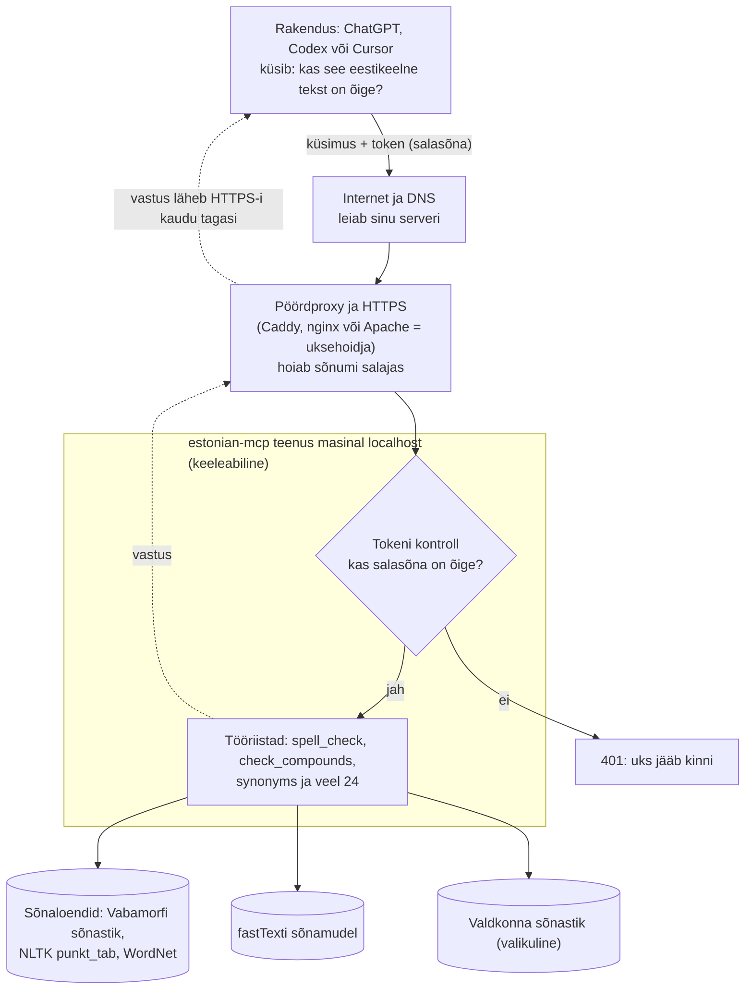

# Serveri paigaldamine ja haldamine

[In English: README.md](README.md)

See dokument kirjeldab, kuidas paigaldada, käivitada ja hallata estonian-mcp iseseisva HTTP-serverina koos bearer-autentimisega VPS-il või deditseeritud serveris Apache ja systemd abil.

Kiire lokaalne stdio, Docker või nginx Docker Compose paigalduse kohta vaata ülesvoolu hoidlat: [silly-geese/estonian-mcp](https://github.com/silly-geese/estonian-mcp) (eriti `README.md` stdio/Dockeri ja `deploy/README.md` nginx kogumi kohta).

## Kuidas see töötab



Lihtsate sõnadega:

- Sinu rakendus (ChatGPT töölauarakendus, Codex või Cursor) saadab teksti koos salajase tokeniga (salasõna).
- DNS ütleb rakendusele, millisele serverile pöörduda.
- Pöördproxy (Caddy, nginx või Apache — uksehoidja) hoiab ühenduse HTTPS-iga privaatsena ja edastab estonian-mcp teenusele ainult need päringud, mida sa soovid.
- Keeleabiline kontrollib kõigepealt tokenit. Vale või puuduva tokeniga saad vastuseks `401` ja midagi muud ei juhtu.
- Õige tokeniga otsib abiline sõnad üles oma sõnaloenditest, fastTexti mudelist ja valikulisest valdkonna sõnastikust ning saadab vastuse sama teed pidi tagasi.
- Abiline saab rääkida ainult sama masina uksehoidjaga. Liivakastireeglitest kinni pidades ei saa ta internetti pöörduda (vaata teenusefaili).

## Haldamine ja testimine

### Seisukontroll

```bash
# Autentimiseta
curl -s https://<DOMAIN>/health
# Peaks tagastama: {"ok": true, "version": "0.7.1", "tools": 27}
```

### MCP initialize ja tools/list

Testi täielikku MCP käepigistust tokeniga. Token loetakse env-failist sisse ilma seda kuvamata:

```bash
# Loe token env-failist muutujasse (ära kuva seda)
TOKEN=$(sudo sed -n 's/^ESTNLTK_MCP_AUTH_TOKEN=//p' /etc/estonian-mcp/estonian-mcp.env)

# Ühised päised
H=(-H "Content-Type: application/json" \
   -H "Accept: application/json, text/event-stream" \
   -H "MCP-Protocol-Version: 2025-06-18")

# Testi initialize
curl -s -w '\nHTTP %{http_code}\n' "${H[@]}" \
  -H "Authorization: Bearer $TOKEN" \
  -d '{"jsonrpc":"2.0","id":1,"method":"initialize","params":{"protocolVersion":"2025-06-18","capabilities":{},"clientInfo":{"name":"test","version":"1"}}}' \
  https://<DOMAIN>/mcp

# Testi tools/list
curl -s "${H[@]}" -H "Authorization: Bearer $TOKEN" \
  -d '{"jsonrpc":"2.0","id":2,"method":"tools/list"}' \
  https://<DOMAIN>/mcp | jq '.result.tools | length'

# Testi tööriista väljakutset
curl -s "${H[@]}" -H "Authorization: Bearer $TOKEN" \
  -d '{"jsonrpc":"2.0","id":3,"method":"tools/call","params":{"name":"spell_check","arguments":{"text":"Tere maailm"}}}' \
  https://<DOMAIN>/mcp

# Puhasta
unset TOKEN

# Testi ilma tokenita (peaks tagastama 401)
curl -s -o /dev/null -w '%{http_code}\n' "${H[@]}" \
  -d '{"jsonrpc":"2.0","id":2,"method":"tools/list"}' \
  https://<DOMAIN>/mcp
```

Oodatavad tulemused:
- Tokeniga vastasid `initialize` ja `tools/list` koodiga 200 ning tööriistu on 27.
- Ilma tokenita või vale tokeniga on vastus 401.

### Tokeni vahetamine

Uue tokeni genereerimine ja teenuse taaskäivitamine:

```bash
# Genereeri uus token ja kirjuta see env-faili
sudo sh -c 'umask 077; printf "ESTNLTK_MCP_AUTH_TOKEN=%s\n" "$(openssl rand -hex 32)" > /etc/estonian-mcp/estonian-mcp.env'

# Taaskäivita teenus
sudo systemctl restart estonian-mcp

# Kontrolli, kas käivitus õnnestus
curl -s https://<DOMAIN>/health
```

Pärast vahetust uuenda tokenit kõigis klientides (Codexi keskkonnamuutuja, Cursori seadistus jne). Vana token lakkab kohe töötamast.

### Uuendamine uuemale commitile

Loe enne uuendamist ülesvoolu CHANGELOG-i ja muudatusi ning kinnita täpne commit-SHA (mitte haru).

```bash
NEW=<full-commit-sha>

cd /opt/estonian-mcp/app
sudo git fetch origin && sudo git -c advice.detachedHead=false checkout "$NEW"

# Uuenda sõltuvusi
sudo env UV_PROJECT_ENVIRONMENT=/opt/estonian-mcp/venv \
  UV_CACHE_DIR=/root/.cache/uv-estonian-mcp \
  UV_PYTHON_DOWNLOADS=never \
  /opt/estonian-mcp/uvtool/bin/uv sync --frozen --no-dev --python python3

# Kui väljalase vajab uusi mudelifaile, hangi need administraatori sammuna
# (teenus ise ei oma võrguühendust, kui liivakast on aktiivne)

# Taaskäivita ja kontrolli
sudo systemctl restart estonian-mcp && curl -s https://<DOMAIN>/health
```

### Tagasipööramine eelmisele versioonile

Uuenduse tagasipööramiseks tee checkout eelmisele commitile, käivita sama `uv sync` ja taaskäivita:

```bash
PREVIOUS=<previous-commit-sha>

cd /opt/estonian-mcp/app
sudo git checkout "$PREVIOUS"

sudo env UV_PROJECT_ENVIRONMENT=/opt/estonian-mcp/venv \
  UV_CACHE_DIR=/root/.cache/uv-estonian-mcp \
  UV_PYTHON_DOWNLOADS=never \
  /opt/estonian-mcp/uvtool/bin/uv sync --frozen --no-dev --python python3

sudo systemctl restart estonian-mcp && curl -s https://<DOMAIN>/health
```

## Apache + systemd paigaldus

See jaotis näitab, kuidas paigaldada estonian-mcp nii, et Apache on pöördproxy ja systemd haldab teenust.

### systemd teenusefail

Loo `/etc/systemd/system/estonian-mcp.service`:

```ini
[Unit]
Description=Estonian MCP server
Documentation=https://github.com/silly-geese/estonian-mcp
After=network-online.target
Wants=network-online.target

[Service]
Type=exec
User=estonian-mcp
Group=estonian-mcp
EnvironmentFile=/etc/estonian-mcp/estonian-mcp.env

# Kasuta python3 venv-i bin/ kataloogist
# See lahendab automaatselt õige Pythoni versiooni (3.10, 3.11, 3.12 või 3.13)
# ja on distributsioonist sõltumatu
ExecStart=/opt/estonian-mcp/venv/bin/python3 \
  /opt/estonian-mcp/app/server.py \
  --transport http \
  --host 127.0.0.1 \
  --port 8081

Restart=on-failure
RestartSec=5s
TimeoutStartSec=60s

# Turvakõvendus
NoNewPrivileges=true
ProtectSystem=strict
ProtectHome=true
PrivateTmp=true
PrivateDevices=true
ProtectKernelTunables=true
ProtectKernelModules=true
ProtectKernelLogs=true
ProtectControlGroups=true
ProtectClock=true
ProtectHostname=true
RestrictNamespaces=true
RestrictRealtime=true
RestrictSUIDSGID=true
LockPersonality=true
CapabilityBoundingSet=
SystemCallArchitectures=native
RestrictAddressFamilies=AF_INET AF_INET6 AF_UNIX
UMask=0077
MemoryMax=4G

# Võrguisolatsioon: teenus saab suhelda ainult loopback-liidesega
IPAddressDeny=any
IPAddressAllow=localhost

# Oleku ja vahemälu kataloogid
# StateDirectory loob automaatselt /var/lib/estonian-mcp (kaasaskantav)
# CacheDirectory loob automaatselt /var/cache/estonian-mcp (kaasaskantav)
StateDirectory=estonian-mcp
CacheDirectory=estonian-mcp

# Luba kirjutada NLTK ja mudelite kataloogidesse
ReadWritePaths=/opt/estonian-mcp/venv/nltk_data
ReadWritePaths=/opt/estonian-mcp/models

# Ajutiste failide kataloog
RuntimeDirectory=estonian-mcp

# Kirjutuskaitstud juurdepääs rakenduse koodile ja seadistusele
ReadOnlyPaths=/opt/estonian-mcp/app
ReadOnlyPaths=/etc/estonian-mcp

[Install]
WantedBy=multi-user.target
```

Põhipunktid:

- Kasutab `python3` venv-i `bin/` kataloogist, mis lahendab automaatselt õige Pythoni versiooni.
- `StateDirectory=estonian-mcp` ja `CacheDirectory=estonian-mcp` on distributsioonist sõltumatud.
- `IPAddressDeny=any` ja `IPAddressAllow=localhost` blokeerivad kogu väljamineva võrguliikluse peale loopback-i.
- Teenus laadib käivitumisel ~33 MB mudeleid ja muutub valmis ~15 sekundiga.

Luba ja käivita teenus:

```bash
sudo systemctl daemon-reload
sudo systemctl enable --now estonian-mcp
sudo systemctl status estonian-mcp
sudo journalctl -u estonian-mcp -f
```

### Apache virtuaalserver

Loo `/etc/apache2/sites-available/estonian-mcp.conf` HTTP-le (port 80) koos ACME väljakutse toega:

```apache
<VirtualHost *:80>
    ServerName <DOMAIN>
    
    # ACME väljakutse Let's Encrypti jaoks
    Alias /.well-known/acme-challenge /var/www/acme-challenge
    <Directory /var/www/acme-challenge>
        Require all granted
    </Directory>
    
    # Suuna kõik muu HTTPS-ile
    RewriteEngine On
    RewriteCond %{REQUEST_URI} !^/\.well-known/acme-challenge/
    RewriteRule ^(.*)$ https://%{HTTP_HOST}$1 [R=301,L]
</VirtualHost>
```

Loo `/etc/apache2/sites-available/estonian-mcp-ssl.conf` HTTPS-le (port 443):

```apache
<VirtualHost *:443>
    ServerName <DOMAIN>
    
    SSLEngine on
    SSLCertificateFile /etc/letsencrypt/live/<DOMAIN>/fullchain.pem
    SSLCertificateKeyFile /etc/letsencrypt/live/<DOMAIN>/privkey.pem
    
    # Kaasaegne SSL-seadistus
    SSLProtocol all -SSLv3 -TLSv1 -TLSv1.1
    SSLCipherSuite HIGH:!aNULL:!MD5
    SSLHonorCipherOrder on
    
    # Turvapäised
    Header always set Strict-Transport-Security "max-age=31536000; includeSubDomains"
    Header always set X-Robots-Tag "noindex, nofollow"
    Header always set X-Content-Type-Options "nosniff"
    
    # Päringu suuruse limiit
    LimitRequestBody 4194304
    
    # Lülita pakkimine välja voogedastuse jaoks
    SetEnv no-gzip 1
    RequestHeader unset Accept-Encoding
    
    # Edasta ainult /mcp ja /health estonian-mcp teenusele
    ProxyPreserveHost On
    ProxyTimeout 3600
    
    <LocationMatch "^/(mcp/?|health)$">
        ProxyPass http://127.0.0.1:8081 timeout=3600 flushpackets=on retry=0
        ProxyPassReverse http://127.0.0.1:8081
        
        # Edasta kliendi IP päringupiirangu jaoks
        RequestHeader set X-Forwarded-For "%{REMOTE_ADDR}s"
    </LocationMatch>
    
    # Tagasta 404 kõigi teiste teede jaoks
    <Location />
        Require all denied
    </Location>
    <LocationMatch "^/(mcp/?|health)$">
        Require all granted
    </LocationMatch>
    
    # Logimine (päringu sisusid ega Authorization päiseid ei logita)
    ErrorLog ${APACHE_LOG_DIR}/estonian_mcp_ssl_error.log
    CustomLog ${APACHE_LOG_DIR}/estonian_mcp_ssl_access.log combined
</VirtualHost>
```

Luba vajalikud Apache moodulid ja saidid:

```bash
# Luba vajalikud moodulid
sudo a2enmod ssl proxy proxy_http headers rewrite

# Luba saidid
sudo a2ensite estonian-mcp estonian-mcp-ssl

# Testi seadistust
sudo apache2ctl configtest

# Laadi Apache uuesti
sudo systemctl reload apache2
```

### Let's Encrypti sertifikaat

```bash
# Loo ACME väljakutse kataloog
sudo mkdir -p /var/www/acme-challenge

# Hangi sertifikaat
sudo certbot certonly --webroot \
  -w /var/www/acme-challenge \
  -d <DOMAIN> \
  --email <YOUR-EMAIL> \
  --agree-tos \
  --no-eff-email

# Laadi Apache uuesti uue sertifikaadi kasutamiseks
sudo systemctl reload apache2

# Testi automaatset uuendamist
sudo certbot renew --dry-run
```

Systemd-teenus `certbot.timer` uuendab sertifikaate automaatselt enne nende aegumist.

### Env-fail

Loo `/etc/estonian-mcp/estonian-mcp.env` õigustega 600:

```bash
sudo mkdir -p /etc/estonian-mcp
sudo sh -c 'umask 077; printf "ESTNLTK_MCP_AUTH_TOKEN=%s\n" "$(openssl rand -hex 32)" > /etc/estonian-mcp/estonian-mcp.env'
sudo chmod 600 /etc/estonian-mcp/estonian-mcp.env
sudo chown root:root /etc/estonian-mcp/estonian-mcp.env
```

Määra usaldusväärse proxy sammude arv päringupiirangu jaoks:

```bash
echo "ESTNLTK_MCP_TRUSTED_PROXY_HOPS=1" | sudo tee -a /etc/estonian-mcp/estonian-mcp.env
```

### Paigalduse kontrollnimekiri

1. Loo süsteemikasutaja `estonian-mcp`
2. Klooni kood kataloogi `/opt/estonian-mcp/app` ja tee checkout kinnitatud commitile
3. Loo Pythoni venv kataloogis `/opt/estonian-mcp/venv` käsuga `uv sync --frozen --no-dev`
4. Hangi mudelid ja ressursid käsuga `uv run python scripts/fetch_resources.py`
5. Loo `/etc/estonian-mcp/estonian-mcp.env` koos tokeni ja proxy sammudega
6. Paigalda systemd teenus ja luba see
7. Seadista Apache ülaltoodud vhostidega
8. Hangi Let's Encrypti sertifikaat
9. Testi ülaltoodud jaotises "Haldamine ja testimine" toodud käskudega

Valikulise valdkonna sõnastiku jaoks aseta oma terminid (üks real) faili `/etc/estonian-mcp/glossary/glossary-ecommerce.txt` ja määra:

```bash
echo "ESTNLTK_MCP_DOMAIN_GLOSSARY=/etc/estonian-mcp/glossary/glossary-ecommerce.txt" | sudo tee -a /etc/estonian-mcp/estonian-mcp.env
```

### Logid ja jälgimine

```bash
# Teenuse olek
sudo systemctl status estonian-mcp

# Teenuse logid (jälgib reaalajas)
sudo journalctl -u estonian-mcp -f

# Apache päringute logi
sudo tail -f /var/log/apache2/estonian_mcp_ssl_access.log

# Apache vigade logi
sudo tail -f /var/log/apache2/estonian_mcp_ssl_error.log

# Kontrolli hiljutisi vigu
sudo journalctl -u estonian-mcp --since "1 hour ago" -p err
```

Server avab `/metrics` otspunkti aadressil `127.0.0.1:8081/metrics` (ülaltoodud Apache seadistuses ei edastata) Prometheuse vormingus loenduritega.
