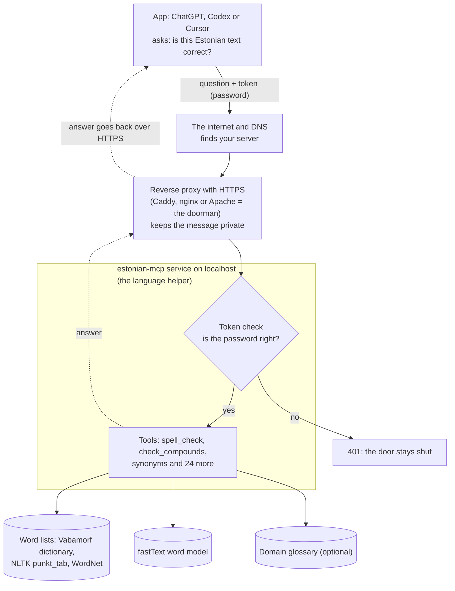

# Server Deployment and Operations

[Eesti keeles: README.et.md](README.et.md)

This document describes how to deploy, run, and maintain estonian-mcp as a self-hosted HTTP server with bearer authentication on a VPS or dedicated host using Apache and systemd.

For the quick-start local stdio, Docker, or nginx Docker Compose deployments, see the upstream repository: [silly-geese/estonian-mcp](https://github.com/silly-geese/estonian-mcp) (especially `README.md` for stdio/Docker and `deploy/README.md` for the nginx stack).

## How it works



In plain words:

- Your app (ChatGPT desktop, Codex or Cursor) sends the text together with a secret token (the password).
- DNS tells the app which server to reach.
- The reverse proxy (Caddy, nginx or Apache — the doorman) keeps the connection private with HTTPS and forwards only the requests you want to the estonian-mcp service.
- The language helper checks the token first. A wrong or missing token gets `401`, and nothing else happens.
- With the right token, the helper looks the words up in its word lists, the fastText model and an optional domain glossary, then sends the answer back the same way.
- The helper can only talk to the doorman on the same machine. It cannot call out to the internet when run with systemd sandboxing (see the service file).

## Operations and testing

### Health check

```bash
# No authentication required
curl -s https://<DOMAIN>/health
# Should return: {"ok": true, "version": "0.7.1", "tools": 27}
```

### MCP initialize and tools/list

Test the full MCP handshake with the token. The token is read from the env file without echoing it:

```bash
# Read the token from the env file into a variable (never echo it)
TOKEN=$(sudo sed -n 's/^ESTNLTK_MCP_AUTH_TOKEN=//p' /etc/estonian-mcp/estonian-mcp.env)

# Set up common headers
H=(-H "Content-Type: application/json" \
   -H "Accept: application/json, text/event-stream" \
   -H "MCP-Protocol-Version: 2025-06-18")

# Test initialize
curl -s -w '\nHTTP %{http_code}\n' "${H[@]}" \
  -H "Authorization: Bearer $TOKEN" \
  -d '{"jsonrpc":"2.0","id":1,"method":"initialize","params":{"protocolVersion":"2025-06-18","capabilities":{},"clientInfo":{"name":"test","version":"1"}}}' \
  https://<DOMAIN>/mcp

# Test tools/list
curl -s "${H[@]}" -H "Authorization: Bearer $TOKEN" \
  -d '{"jsonrpc":"2.0","id":2,"method":"tools/list"}' \
  https://<DOMAIN>/mcp | jq '.result.tools | length'

# Test a tool call
curl -s "${H[@]}" -H "Authorization: Bearer $TOKEN" \
  -d '{"jsonrpc":"2.0","id":3,"method":"tools/call","params":{"name":"spell_check","arguments":{"text":"Tere maailm"}}}' \
  https://<DOMAIN>/mcp

# Clean up
unset TOKEN

# Test without token (should return 401)
curl -s -o /dev/null -w '%{http_code}\n' "${H[@]}" \
  -d '{"jsonrpc":"2.0","id":2,"method":"tools/list"}' \
  https://<DOMAIN>/mcp
```

Expected results:
- With the token, `initialize` and `tools/list` both return 200, with 27 tools.
- Without the token or with a wrong one, the reply is 401.

### Token rotation

To generate a new token and restart the service:

```bash
# Generate a new token and write it to the env file
sudo sh -c 'umask 077; printf "ESTNLTK_MCP_AUTH_TOKEN=%s\n" "$(openssl rand -hex 32)" > /etc/estonian-mcp/estonian-mcp.env'

# Restart the service
sudo systemctl restart estonian-mcp

# Verify it started successfully
curl -s https://<DOMAIN>/health
```

After rotation, update the token in every client (Codex environment variable, Cursor config, etc.). The old token stops working immediately.

### Update to a new upstream commit

Read the upstream CHANGELOG and diff before updating, and pin an exact commit SHA (never a branch).

```bash
NEW=<full-commit-sha>

cd /opt/estonian-mcp/app
sudo git fetch origin && sudo git -c advice.detachedHead=false checkout "$NEW"

# Update dependencies
sudo env UV_PROJECT_ENVIRONMENT=/opt/estonian-mcp/venv \
  UV_CACHE_DIR=/root/.cache/uv-estonian-mcp \
  UV_PYTHON_DOWNLOADS=never \
  /opt/estonian-mcp/uvtool/bin/uv sync --frozen --no-dev --python python3

# If the release needs new model files, fetch them as an admin step
# (the service itself has no network when sandboxed)

# Restart and verify
sudo systemctl restart estonian-mcp && curl -s https://<DOMAIN>/health
```

### Rollback to a previous version

To roll back an update, checkout the previous commit, run the same `uv sync`, then restart:

```bash
PREVIOUS=<previous-commit-sha>

cd /opt/estonian-mcp/app
sudo git checkout "$PREVIOUS"

sudo env UV_PROJECT_ENVIRONMENT=/opt/estonian-mcp/venv \
  UV_CACHE_DIR=/root/.cache/uv-estonian-mcp \
  UV_PYTHON_DOWNLOADS=never \
  /opt/estonian-mcp/uvtool/bin/uv sync --frozen --no-dev --python python3

sudo systemctl restart estonian-mcp && curl -s https://<DOMAIN>/health
```

## Apache + systemd deployment

This section shows how to deploy estonian-mcp with Apache as the reverse proxy and systemd managing the service.

### systemd service unit

Create `/etc/systemd/system/estonian-mcp.service`:

```ini
[Unit]
Description=Estonian MCP server
Documentation=https://github.com/silly-geese/estonian-mcp
After=network-online.target
Wants=network-online.target

[Service]
Type=exec
User=estonian-mcp
Group=estonian-mcp
EnvironmentFile=/etc/estonian-mcp/estonian-mcp.env

# Use python3 from the venv's bin/ directory
# This automatically resolves to the correct Python version (3.10, 3.11, 3.12 or 3.13)
# and is portable across distributions
ExecStart=/opt/estonian-mcp/venv/bin/python3 \
  /opt/estonian-mcp/app/server.py \
  --transport http \
  --host 127.0.0.1 \
  --port 8081

Restart=on-failure
RestartSec=5s
TimeoutStartSec=60s

# Security hardening
NoNewPrivileges=true
ProtectSystem=strict
ProtectHome=true
PrivateTmp=true
PrivateDevices=true
ProtectKernelTunables=true
ProtectKernelModules=true
ProtectKernelLogs=true
ProtectControlGroups=true
ProtectClock=true
ProtectHostname=true
RestrictNamespaces=true
RestrictRealtime=true
RestrictSUIDSGID=true
LockPersonality=true
CapabilityBoundingSet=
SystemCallArchitectures=native
RestrictAddressFamilies=AF_INET AF_INET6 AF_UNIX
UMask=0077
MemoryMax=4G

# Network isolation: service can only talk to loopback
IPAddressDeny=any
IPAddressAllow=localhost

# State and cache directories
# StateDirectory creates /var/lib/estonian-mcp automatically (portable)
# CacheDirectory creates /var/cache/estonian-mcp automatically (portable)
StateDirectory=estonian-mcp
CacheDirectory=estonian-mcp

# Allow writes to NLTK and model directories
ReadWritePaths=/opt/estonian-mcp/venv/nltk_data
ReadWritePaths=/opt/estonian-mcp/models

# Runtime directory for temporary files
RuntimeDirectory=estonian-mcp

# Read-only access to application code and configuration
ReadOnlyPaths=/opt/estonian-mcp/app
ReadOnlyPaths=/etc/estonian-mcp

[Install]
WantedBy=multi-user.target
```

Key points:

- Uses `python3` from the venv's `bin/` directory, which automatically resolves to the correct Python version.
- `StateDirectory=estonian-mcp` and `CacheDirectory=estonian-mcp` are portable across distributions.
- `IPAddressDeny=any` with `IPAddressAllow=localhost` blocks all outbound network access except loopback.
- The service loads ~33 MB of models at startup and takes ~15 seconds to become ready.

Enable and start the service:

```bash
sudo systemctl daemon-reload
sudo systemctl enable --now estonian-mcp
sudo systemctl status estonian-mcp
sudo journalctl -u estonian-mcp -f
```

### Apache virtual host

Create `/etc/apache2/sites-available/estonian-mcp.conf` for HTTP (port 80) with ACME challenge support:

```apache
<VirtualHost *:80>
    ServerName <DOMAIN>
    
    # ACME challenge for Let's Encrypt
    Alias /.well-known/acme-challenge /var/www/acme-challenge
    <Directory /var/www/acme-challenge>
        Require all granted
    </Directory>
    
    # Redirect everything else to HTTPS
    RewriteEngine On
    RewriteCond %{REQUEST_URI} !^/\.well-known/acme-challenge/
    RewriteRule ^(.*)$ https://%{HTTP_HOST}$1 [R=301,L]
</VirtualHost>
```

Create `/etc/apache2/sites-available/estonian-mcp-ssl.conf` for HTTPS (port 443):

```apache
<VirtualHost *:443>
    ServerName <DOMAIN>
    
    SSLEngine on
    SSLCertificateFile /etc/letsencrypt/live/<DOMAIN>/fullchain.pem
    SSLCertificateKeyFile /etc/letsencrypt/live/<DOMAIN>/privkey.pem
    
    # Modern SSL configuration
    SSLProtocol all -SSLv3 -TLSv1 -TLSv1.1
    SSLCipherSuite HIGH:!aNULL:!MD5
    SSLHonorCipherOrder on
    
    # Security headers
    Header always set Strict-Transport-Security "max-age=31536000; includeSubDomains"
    Header always set X-Robots-Tag "noindex, nofollow"
    Header always set X-Content-Type-Options "nosniff"
    
    # Request size limit
    LimitRequestBody 4194304
    
    # Disable compression for streaming
    SetEnv no-gzip 1
    RequestHeader unset Accept-Encoding
    
    # Proxy only /mcp and /health to the estonian-mcp service
    ProxyPreserveHost On
    ProxyTimeout 3600
    
    <LocationMatch "^/(mcp/?|health)$">
        ProxyPass http://127.0.0.1:8081 timeout=3600 flushpackets=on retry=0
        ProxyPassReverse http://127.0.0.1:8081
        
        # Forward client IP for rate limiting
        RequestHeader set X-Forwarded-For "%{REMOTE_ADDR}s"
    </LocationMatch>
    
    # Return 404 for all other paths
    <Location />
        Require all denied
    </Location>
    <LocationMatch "^/(mcp/?|health)$">
        Require all granted
    </LocationMatch>
    
    # Logging (no request bodies, no Authorization headers)
    ErrorLog ${APACHE_LOG_DIR}/estonian_mcp_ssl_error.log
    CustomLog ${APACHE_LOG_DIR}/estonian_mcp_ssl_access.log combined
</VirtualHost>
```

Enable the required Apache modules and sites:

```bash
# Enable required modules
sudo a2enmod ssl proxy proxy_http headers rewrite

# Enable the sites
sudo a2ensite estonian-mcp estonian-mcp-ssl

# Test the configuration
sudo apache2ctl configtest

# Reload Apache
sudo systemctl reload apache2
```

### Let's Encrypt certificate

```bash
# Create the ACME challenge directory
sudo mkdir -p /var/www/acme-challenge

# Obtain the certificate
sudo certbot certonly --webroot \
  -w /var/www/acme-challenge \
  -d <DOMAIN> \
  --email <YOUR-EMAIL> \
  --agree-tos \
  --no-eff-email

# Reload Apache to use the new certificate
sudo systemctl reload apache2

# Test automatic renewal
sudo certbot renew --dry-run
```

The `certbot.timer` systemd unit automatically renews certificates before they expire.

### Environment file

Create `/etc/estonian-mcp/estonian-mcp.env` with mode 600:

```bash
sudo mkdir -p /etc/estonian-mcp
sudo sh -c 'umask 077; printf "ESTNLTK_MCP_AUTH_TOKEN=%s\n" "$(openssl rand -hex 32)" > /etc/estonian-mcp/estonian-mcp.env'
sudo chmod 600 /etc/estonian-mcp/estonian-mcp.env
sudo chown root:root /etc/estonian-mcp/estonian-mcp.env
```

Set the trusted proxy hop count for rate limiting:

```bash
echo "ESTNLTK_MCP_TRUSTED_PROXY_HOPS=1" | sudo tee -a /etc/estonian-mcp/estonian-mcp.env
```

### Deployment checklist

1. Create the `estonian-mcp` system user
2. Clone the code to `/opt/estonian-mcp/app` and checkout a pinned commit
3. Create the Python venv at `/opt/estonian-mcp/venv` with `uv sync --frozen --no-dev`
4. Fetch the models and resources with `uv run python scripts/fetch_resources.py`
5. Create `/etc/estonian-mcp/estonian-mcp.env` with the token and proxy hops
6. Install the systemd service and enable it
7. Configure Apache with the vhosts above
8. Obtain the Let's Encrypt certificate
9. Test with the commands in "Operations and testing" above

For an optional domain glossary, place your terms (one per line) in `/etc/estonian-mcp/glossary/glossary-ecommerce.txt` and set:

```bash
echo "ESTNLTK_MCP_DOMAIN_GLOSSARY=/etc/estonian-mcp/glossary/glossary-ecommerce.txt" | sudo tee -a /etc/estonian-mcp/estonian-mcp.env
```

### Logs and monitoring

```bash
# Service status
sudo systemctl status estonian-mcp

# Service logs (follows live)
sudo journalctl -u estonian-mcp -f

# Apache access log
sudo tail -f /var/log/apache2/estonian_mcp_ssl_access.log

# Apache error log
sudo tail -f /var/log/apache2/estonian_mcp_ssl_error.log

# Check for recent errors
sudo journalctl -u estonian-mcp --since "1 hour ago" -p err
```

The server exposes a `/metrics` endpoint on `127.0.0.1:8081/metrics` (not proxied by Apache in the config above) with Prometheus-format counters.
